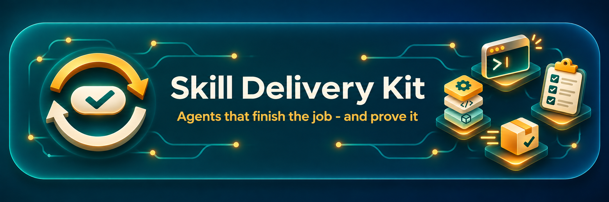
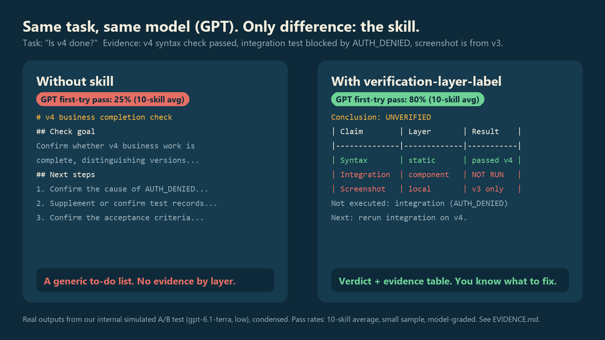
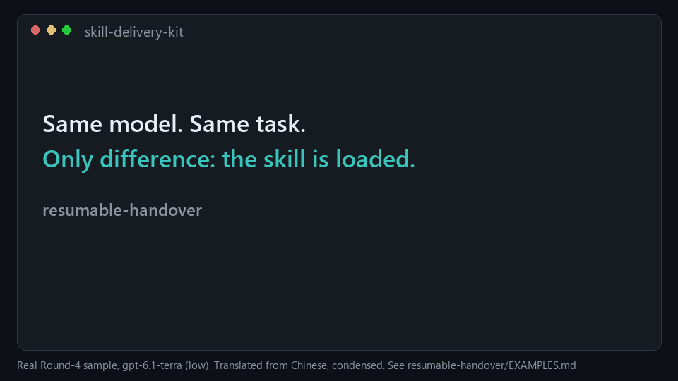

<p align="center">
  
</p>

<p align="center">
  <b>Stop your coding agent from saying “done” when nothing was verified.</b><br>
  10 drop-in skills (3 free in this repo, 7 paid on Agensi) that make Codex, Claude Code, Cursor, ChatGPT and DeepSeek hand over real, checkable work on the first try.
</p>

<p align="center">
  <a href="EVIDENCE.md"></a>
  <a href="EVIDENCE.md"></a>
</p>
<p align="center">
  
  
  
  
  
  
</p>
<p align="center"><sub>Pass rates: internal simulated A/B tasks, 10-skill average, model-graded, small sample. Full method and limits in <a href="EVIDENCE.md">EVIDENCE.md</a>.</sub></p>

<p align="center">
  <a href="#-pick-your-pain">Pick your pain</a> ·
  <a href="#-install-in-30-seconds">Install</a> ·
  <a href="#-see-it-work">See it work</a> ·
  <a href="#-whats-in-a-skill">What's inside</a> ·
  <a href="#-get-all-10">Get all 10</a> ·
  <a href="#-faq">FAQ</a> ·
  <a href="#-中文">中文</a>
</p>

---

## The problem

You ask your agent to finish a task. It comes back with a confident summary.

Then you find out the integration test never ran, the screenshot was from the old version, the “retry” sent the email twice, and the next session has to rediscover everything from scratch.

The model is not stupid. It just has no habit of **separating what it checked from what it assumed**, and no fixed shape for handing work over. Each skill here installs **one** of those habits — nothing else, no extra ceremony.

<p align="center">
  
</p>

<p align="center">
  
</p>

## 🎯 Pick your pain

| When this happens… | Install this | |
|---|---|:-:|
| A new session has to rediscover everything you already did | [`resumable-handover`](resumable-handover) | **Free** |
| A send timed out and you do not know whether it went through | [`unknown-delivery-reconciliation`](unknown-delivery-reconciliation) | **Free** |
| The form *shows* your value but the app never accepted it | [`reactive-form-input`](reactive-form-input) | **Free** |
| “Tests pass” — but nobody says *which* tests, on *which* version | [`verification-layer-label`](https://www.agensi.io/skills/done-means-verified-report-what-was-actually-checked) | $5 |
| A vague request turns into the wrong deliverable | [`intent-to-acceptance`](https://www.agensi.io/skills/vague-request-to-clear-acceptance-criteria) | $5 |
| Debugging goes in circles, one random fix after another | [`hypothesis-led-diagnosis`](https://www.agensi.io/skills/debug-by-hypothesis-find-the-cause-before-you-fix) | $5 |
| JSON parses fine but breaks the consumer at 0, 1 or many items | [`powershell-json-shape-check`](https://www.agensi.io/skills/powershell-json-check-catch-single-item-and-null-bugs) | $5 |
| The numbers look right but the formulas were flattened to values | [`spreadsheet-formula-preservation`](https://www.agensi.io/skills/spreadsheet-edit-check-did-any-formulas-get-lost) | $5 |
| A PDF or scan goes down the wrong extraction path | [`document-format-triage`](https://www.agensi.io/skills/pdf-triage-text-form-fields-or-scan-pick-the-route) | $5 |
| A sub-agent gets a brief it cannot act on alone | [`parallel-task-contract`](https://www.agensi.io/skills/sub-agent-task-briefs-split-work-without-conflicts) | $5 |

The 3 free skills are complete on their own. If you want the other 7: **[all 7 paid skills for US$14.90](https://www.agensi.io/bundles/skill-delivery-kit-complete-bundle)** (US$5 each otherwise), sold on [Agensi](https://www.agensi.io/creators/td-w).

## ⚡ Install in 30 seconds

```bash
npx skills add tdw8147-crypto/skill-delivery-kit
```

The installer lists the 3 free skills in this repo and lets you choose what to install. Each one also comes as a standalone Chinese edition (the names ending in `-zh`); pick one language per skill. Needs Node.js. One skill, no prompts:

```bash
npx skills add tdw8147-crypto/skill-delivery-kit --skill resumable-handover -a claude-code -y --copy
```

**Manual install (no Node.js):**

```bash
git clone https://github.com/tdw8147-crypto/skill-delivery-kit.git
```

<details open>
<summary><b>Claude Code</b></summary>

```bash
mkdir -p ~/.claude/skills
cp -R skill-delivery-kit/resumable-handover ~/.claude/skills/
```
Claude Code loads the skill automatically when the task matches its description. Restart the session after copying.

Or install all three as one Claude Code plugin:

```
/plugin marketplace add tdw8147-crypto/skill-delivery-kit
/plugin install skill-delivery-kit@skill-delivery-kit
```
</details>

<details>
<summary><b>Codex CLI / Codex app</b></summary>

```bash
mkdir -p ~/.agents/skills
cp -R skill-delivery-kit/resumable-handover ~/.agents/skills/
```
</details>

<details>
<summary><b>Cursor</b></summary>

Create `.cursor/rules/resumable-handover.mdc` in your project and paste the contents of `SKILL.md` into it.
</details>

<details>
<summary><b>ChatGPT, DeepSeek or any chat app (no install)</b></summary>

Paste the contents of `SKILL.md` into Custom Instructions, a Project's instructions, or the first message of a chat. For Chinese, paste `SKILL.zh.md` instead. Load one language at a time.
</details>

<details>
<summary><b>All three free skills at once (bash / Git Bash / WSL)</b></summary>

```bash
mkdir -p ~/.claude/skills ~/.agents/skills
for s in resumable-handover unknown-delivery-reconciliation reactive-form-input; do
  cp -R "skill-delivery-kit/$s" ~/.claude/skills/
  cp -R "skill-delivery-kit/$s" ~/.agents/skills/
done
```
</details>

Then just work normally. Try: *“Hand this task over with one clear next action.”*

## 👀 See it work

**Task:** “Is v4 done?” The agent has three pieces of evidence: a passing v4 syntax check, an integration test blocked by `AUTH_DENIED`, and a screenshot from v3.

<table>
<tr><th width="50%">Without the skill</th><th width="50%">With <code>verification-layer-label</code></th></tr>
<tr valign="top"><td>

```text
# v4 business completion check
## Check goal
Confirm whether v4 business work is
complete, distinguishing versions...
## Next steps
1. Confirm the cause of AUTH_DENIED...
2. Supplement or confirm test records...
3. Confirm the acceptance criteria...
```
A generic checklist. Nothing is tied to a version, an environment or a verification layer.

</td><td>

```text
Conclusion: UNVERIFIED
| Claim       | Layer      | Result     |
|-------------|------------|------------|
| Syntax      | static     | passed, v4 |
| Integration | component  | NOT RUN    |
| Screenshot  | local      | v3 only    |
Not executed: integration (AUTH_DENIED)
Next: rerun integration on v4.
```
A verdict, an evidence table and the one action that closes the gap.

</td></tr>
</table>

<sub>Real first submissions from our internal test run (gpt-6.1-terra, low), translated from Chinese and condensed (`…`). Originals are in <a href="EVIDENCE.md">EVIDENCE.md</a>.</sub>

**More real before/after pairs, one per free skill, with full inputs, both outputs and the grader's checklist:** [resumable-handover](resumable-handover/EXAMPLES.md) · [unknown-delivery-reconciliation](unknown-delivery-reconciliation/EXAMPLES.md) · [reactive-form-input](reactive-form-input/EXAMPLES.md)

## 📦 What's in a skill

Every skill is one folder you can read in five minutes:

| File | What it gives you |
|---|---|
| `SKILL.md` | When to use it (and when not to), core rules with the reason for each, a step-by-step workflow, a fill-in output template, worked good-vs-bad examples, a red-flags table and a pre-delivery self-check |
| `SKILL.zh.md` | The same skill in natural Chinese |
| `README.md` | The problem, a real before/after, measured numbers, trigger phrases and install steps |
| `EXAMPLES.md` | Free skills only: one complete real test pair with inputs, both outputs and the grading |

No scripts, no plugins, no new permissions. They are plain-text instructions, so you can read every line before you trust it.

### Design rules we follow

- **One skill, one failure pattern.** Load only what you need; nothing assumes another skill is installed.
- **Deliver first.** The skills cut hedging and re-confirming. The agent hands over a usable artifact in the same turn instead of asking five clarifying questions.
- **Honest status.** “Not run”, “failed” and “unknown” stay separate. Nothing is marked done without evidence.
- **Stop at delivery.** No gold-plating, no extra verification outside the goal.

## 📊 Results

Round-4 internal A/B test: same model, same task, with vs without the skill. Five tasks × three repeats per skill and model.

| Skill | GPT without → with | DeepSeek without → with |
|---|:-:|:-:|
| document-format-triage | 21% → **100%** | 80% → **100%** |
| hypothesis-led-diagnosis | 0% → **75%** | 82% → **100%** |
| intent-to-acceptance | 36% → **83%** | 92% → **100%** |
| parallel-task-contract | 18% → **33%** | 62% → **100%** |
| powershell-json-shape-check | 9% → **100%** | 36% → **100%** |
| reactive-form-input | 33% → **100%** | 80% → **100%** |
| resumable-handover | 23% → **100%** | 67% → **100%** |
| spreadsheet-formula-preservation | 27% → **75%** | 79% → **100%** |
| unknown-delivery-reconciliation | 15% → **33%** | 92% → **100%** |
| verification-layer-label | 69% → **100%** | 91% → **100%** |
| **Average** | **25% → 80%** | **76% → 100%** |

Metric: first formal delivery meets *all* acceptance criteria. Measured on the earlier compact edition of each skill (v0.2); this v1.0 adds templates, examples and checklists on top of the same rules and has not been re-measured yet. Low-cost models (gpt-6.1-terra low, deepseek-v4.1-flash), graded by a model, small sample. This is not a guarantee; read [EVIDENCE.md](EVIDENCE.md) for the denominators, censored samples and what we did **not** test.

## 🛒 Get all 10

| | Free (this repo) | Single skill | Complete bundle |
|---|:-:|:-:|:-:|
| Price | $0 | **US$5** | **US$14.90** |
| Skills | 3 | 1 of your choice | All 7 paid (+ the 3 free = 10) |
| English + Chinese | ✅ | ✅ | ✅ |
| Updates to that skill | ✅ | ✅ | ✅ |
| | [Install above](#-install-in-30-seconds) | [Browse on Agensi](https://www.agensi.io/creators/td-w) | **[Get the bundle →](https://www.agensi.io/bundles/skill-delivery-kit-complete-bundle)** |

Paid skills are sold through [Agensi](https://www.agensi.io/creators/td-w), a marketplace for agent skills (every listing passes its security scan).

## ❓ FAQ

<details><summary><b>Which clients does this work with?</b></summary>

Anything that loads `SKILL.md` (Claude Code, Codex CLI and app), Cursor via rules, and any chat app where you can paste instructions (ChatGPT, DeepSeek, Claude.ai). It is plain text, not a plugin.
</details>

<details><summary><b>How is this different from writing a good prompt?</b></summary>

Each skill is a tested prompt with a fixed output shape, worked examples and a self-check, built from failures we kept seeing in real agent runs. You get the result without the trial and error.
</details>

<details><summary><b>Will it make my agent slower or more cautious?</b></summary>

The opposite is the goal. The skills remove re-confirming and hedging and tell the agent to deliver in the same turn. They add structure to the output, not extra steps before it.
</details>

<details><summary><b>Does it change tool permissions or run anything?</b></summary>

No. Skills only shape how the agent organises its output and next step, using the access your client already has.
</details>

<details><summary><b>Can I edit the skills?</b></summary>

Yes. The free skills are MIT-licensed. Paid skills may be edited for your own use; see the licence in the download.
</details>

<details><summary><b>Refunds?</b></summary>

The refund terms are shown at checkout. Try the three free skills first. They use the same format as the paid ones.
</details>

## 🀄 中文

**让编码 AI 别再“说做完了”却什么都没验证。**
10 个即插即用的技能（本仓库 3 个免费，另 7 个在 Agensi），让 Codex、Claude Code、Cursor、ChatGPT 和 DeepSeek 第一次就交出可核对、能直接用的结果。

- 内部模拟 A/B 测试（10 个技能平均，小样本，模型评分，测的是上一版精简技能）：GPT 首次交付全部达标率约 **25% → 80%**，DeepSeek 约 **76% → 100%**。详见 EVIDENCE.md。
- 一个技能只解决一种失败模式：交接丢上下文、超时后重复发送、表单看似填好其实没生效、“测试通过”却说不清测了什么……
- 每个技能都有英文和中文两版，包含使用时机、规则、步骤、可直接填写的模板、正反例和交付前自检。
- 本仓库免费提供 3 个技能（MIT 许可）；另外 7 个付费技能单品 US$5，[7 个合集 US$14.90](https://www.agensi.io/bundles/skill-delivery-kit-complete-bundle)，在 Agensi 购买。
- 每个免费技能文件夹里都有 `EXAMPLES.md`：一组完整的真实测试对比（输入资料、两份原始输出、评分项）。
- 安装：`npx skills add tdw8147-crypto/skill-delivery-kit`（需要 Node.js）；或手动复制技能文件夹到 `~/.claude/skills/`（Claude Code）或 `~/.agents/skills/`（Codex）；聊天应用直接粘贴 `SKILL.zh.md` 的内容。
- 中文版可以单独安装，技能名以 `-zh` 结尾，例如 `npx skills add tdw8147-crypto/skill-delivery-kit --skill resumable-handover-zh`。中文版和英文版装一个就够。

## License

The public repository and its three free skills are [MIT licensed](LICENSE). Paid skills are licensed separately at purchase.
