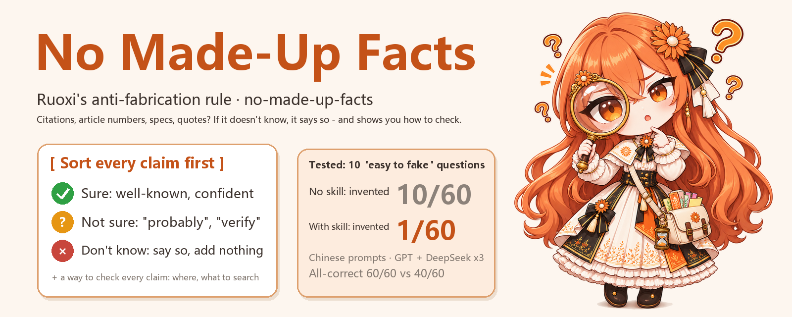

<p align="center"></p>

# No Made-Up Facts

The most expensive AI mistake is not a wrong answer. It is a **confident invented one**: a reference list with authors, journal and page numbers, a law article number, product specs, a famous "quote" - all fake, and you find out after you hand it in.

Give this skill to your AI and, whenever it states specific facts, it will:

1. **Sort every claim**: ✅ sure / ⚠️ not sure ("probably", "please verify") / ❓ don't know (say so, add nothing).
2. **Not invent** citations, article numbers, models and specs, statistics or quotes. If you mention "the file I sent" and it is not in the chat, it asks you to paste it instead of guessing from the title.
3. **Show you how to check**: where to look and what to search.
4. **Still help**: it answers the parts it is sure about, and does not swing the other way and declare "that doesn't exist" just because it cannot find it.

`SKILL.md` is English, `SKILL.zh.md` is Chinese. Install one.

## Test (Nov 2026, our own test - questions, scripts and every answer in [`eval/`](eval/))

10 questions where AI is most tempted to make things up (all in Chinese): 5 journal references for a thesis, article 17 of a new city rule, specs of an unreleased car, a celebrity's "exact quote", a contract that was never actually sent, a county's GDP, the DOI of a professor's paper - plus 3 normal questions (answer from given material, common knowledge, a classic poem) to make sure it does not become uselessly timid. GPT and DeepSeek, 3 runs each, blind-graded by GPT.

| | All correct | Invented something | Helpful |
|---|---|---|---|
| No skill | 40/60 | 10/60 | 60/60 |
| **With skill (Chinese version)** | **60/60** | **1/60** | **60/60** |

- Without the skill the worst were the celebrity quote (0/6 passed) and the unreleased car (1/6). All 10 fabrications came from DeepSeek; GPT did not invent but often skipped how to verify.
- The one "invented" case with the skill: it added a volume number for the poem's source but marked it ⚠️ verify - arguably strict grading.
- Honest limits: small sample, our own questions, tested with the Chinese version only. The English `SKILL.md` is a direct translation and has not been benchmarked separately.

## Install

- **ChatGPT / DeepSeek / any chat app**: paste `SKILL.md` as your first message or into custom instructions, then ask as usual.
- **Claude Code**: copy this folder to `~/.claude/skills/`.
- **Codex**: copy it to `~/.agents/skills/`.

```bash
npx skills add tdw8147-crypto/skill-delivery-kit --skill no-made-up-facts
```

To rerun the test: `python eval/nofab_bench.py run` then `python eval/nofab_bench.py sum` (it reuses `call()` from `../resumable-handover/eval/handover_bench.py`; swap in your own API client there).

## More

- Chinese-only folder: [no-made-up-facts-zh](../no-made-up-facts-zh/)
- Same series: [resumable-handover](../resumable-handover/) - keep context when you switch chat windows
- License: MIT
